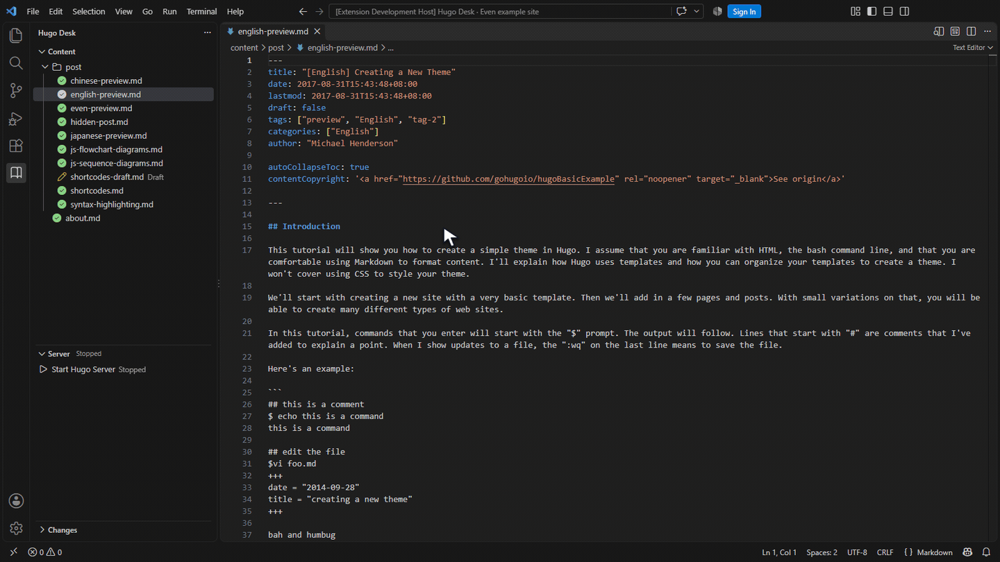
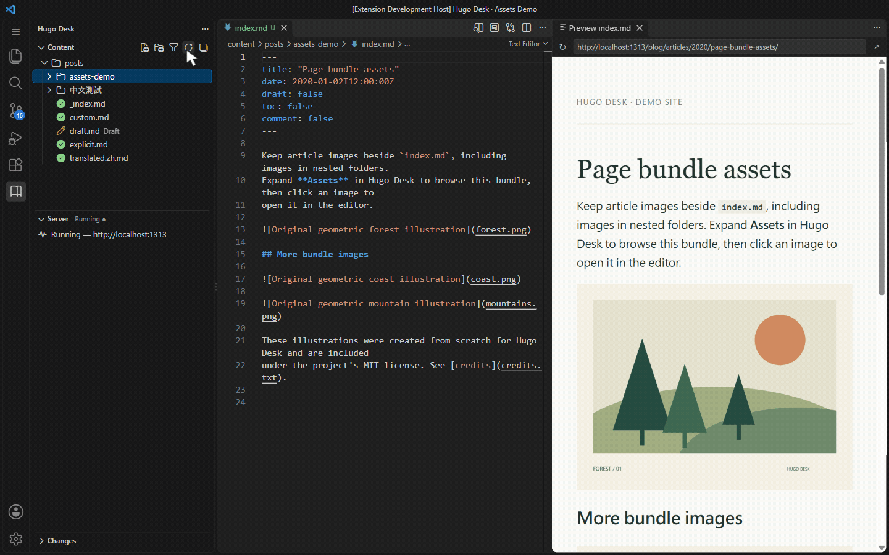

# Hugo Desk

**Write, organize, and preview Hugo content in your editor.**

A focused workspace for Hugo: browse articles without the rest of your site's
source files, keep bundle assets together, and preview your writing in place.

[VS Code Marketplace](https://marketplace.visualstudio.com/items?itemName=gene891212.hugo-desk) ·
[Open VSX](https://open-vsx.org/extension/gene891212/hugo-desk)

Extension ID: `gene891212.hugo-desk`. If a store listing is not available yet,
install the VSIX manually using the steps below.

**Article preview**

Start **Hugo Server** to open the preview, then switch between English, Japanese,
syntax highlighting, and shortcode examples from
[Even's exampleSite](https://github.com/olOwOlo/hugo-theme-even/tree/master/exampleSite):
the preview follows each article in place.

**Page bundle assets**

Keep images beside your article, expand **Assets**, and browse images in the
editor while the site preview stays visible. The demo uses original Forest,
Coast, and Mountains illustrations included under the project's MIT license.

[View a still screenshot](media/screenshot.png) · [Sample credits](media/ATTRIBUTION.md)

## Get started

1. Install [Hugo](https://gohugo.io/installation/). Check that `hugo version` works
   in your editor's terminal. Install Git to use the Changes view.
2. Search Extensions for `gene891212.hugo-desk`, or install the VSIX using
   **Extensions → … → Install from VSIX…**.
3. Open your Hugo project folder and trust the workspace.
4. Select **Hugo Desk** in the Activity Bar, then open an article in **Content**.
5. Click **Start Hugo Server** in **Server**. Use **Start Hugo Server (Debug,
   includes drafts)** to preview drafts.

VS Code 1.90 or later is required. Antigravity can install the same VSIX through standard
VS Code APIs; compatibility still needs verification for your editor version.

## A focused writing workspace

- **Content:** Browse `content/`, search titles and paths, or filter Draft,
  Scheduled, Published, recently modified articles, and sections.
- **Page bundles:** `index.md` stays easy to find. Two or more neighboring assets
  are grouped under **Images** or **Assets**, including nested folders. Section
  folders containing `_index.md` remain normal folders.
- **New articles:** **New File** uses `hugo new` for `.md` files and your own
  archetypes. **New Post Folder** creates a leaf bundle with `index.md`.
- **File operations:** Rename, copy, cut, paste, drag to move, reveal in the file
  manager, and copy paths. Moves refuse overwrites; copies find a free name.
  Delete asks for confirmation and requests the system Trash.
- **Changes:** Group pending Git changes by article, with site files in their own
  row and recent commits in a collapsed group. This view does not commit or deploy.

Status icons reflect local front matter: **Draft** takes priority, a future
`publishDate` (or `date`) is **Scheduled**, otherwise **Published**. They do not
confirm deployment or evaluate cascade, custom date mappings, expiry, or `_build`.
Invalid YAML/TOML shows **Invalid front matter**; see the tooltip or
**Output → Hugo Desk** for details.

## Preview your writing

Preview URLs come from Hugo, preserving Unicode, permalinks, languages, and HTML
paths on the local server.

An open preview follows the active Markdown article without stealing focus or
changing editor groups. Closing it stops following; a start button reopens it.
**Reload** refreshes the page; **Open in external browser** opens the local URL.

Save content or configuration changes to update preview paths. **Refresh Content**
also refreshes them. If a URL cannot be resolved, the previous preview stays open
and a message explains the problem. Normal mode does not render drafts or future pages.

### Server controls and port conflicts

A new server session tries port 1313. If that port is occupied, choose one of
these options; **Use Another Port** appears first on Windows, macOS, and Linux.

| Choice | What happens |
| --- | --- |
| **Use Another Port** | Start this project's Hugo on a free local port. The preview, browser link, and mode switches use that port. |
| **Use Existing** | Use the responding HTTP service and show **External (mode unknown)**. Its project and Hugo mode cannot be verified, so it may not match this project's preview URLs. |
| **Cancel** | Leave the existing service alone without starting another server. |

Switching Normal/Debug restarts the server Hugo Desk started and keeps its
selected port. Switching back to Normal removes draft pages from the preview.
**Stop Hugo Server** stops that server and cancels any pending start or preview
loading. You can start again immediately after cancelling.

Hugo Desk does not stop external services or force-kill processes by port.
Servers left running by older versions are treated as external services; stop
those in their original terminal if you no longer need them.

### Reloading the editor

Hugo Desk remembers the selected port and mode and reconnects if its terminal
survives the reload. An open preview resumes following articles if it was
following before the reload and `followActiveEditor` is enabled.

If the server has stopped, click **Start Hugo Server** to run it again. Restoring
a preview or switching articles never starts a server automatically. A preview
that was closed stays closed, and following disabled by Stop stays off until Start.

## Settings

Settings and commands use the `blogExplorer` prefix.

| Setting | Default | Behavior |
| --- | --- | --- |
| `blogExplorer.previewLocation` | `beside` | First open beside the editor, or use `active` for the current group. |
| `blogExplorer.followActiveEditor` | `true` | Follow the active Markdown article while the preview is open. |
| `blogExplorer.newFileTemplate` | `true` | Use `hugo new` for `.md` files; `false` creates empty files. |

With Content focused, F2 renames, Delete deletes (Cmd+Backspace on macOS), and
Ctrl+C/X/V copy/cut/paste (Cmd on macOS). New File, New Post Folder, and Paste use
the selected directory, or the content root when nothing is selected.

## Current scope and troubleshooting

- Discovery selects the first workspace folder with a root `hugo.*` or `config.*`
  file and a `content/` directory. Config-directory-only projects, nested roots,
  custom content mounts, and multiple active sites are not supported yet.
- The server uses `hugo` on PATH, `development`, and port 1313 or an automatically
  selected free port after a conflict. Custom executable paths, environments,
  manually configured ports, and different server ports per language are not
  configurable in this release.
- Missing Hugo produces installation guidance. For build errors, inspect the
  integrated terminal. URL-index errors also appear in **Output → Hugo Desk**;
  fix the configuration, save, and refresh Content.
- A trusted filesystem workspace is required. Browser-only VS Code and virtual
  filesystems are unsupported. Remote hosts/port forwarding need separate testing.

## Platform validation

| Platform | Verification so far |
| --- | --- |
| Windows | Real terminal/Webview lifecycle checks passed in VS Code 1.90.2 and 1.142.0, including alternate ports, mode switching, reconnecting to a running terminal, and stopping only the owned server. Full window reload and restored article following were also checked in 1.142.0. |
| macOS / Linux | Module tests, real Hugo lifecycle checks, VS Code 1.90.2 terminal/Webview tests, dependency audit, and VSIX packaging passed in CI. Visual verification remains pending. |

Controller reactivation and restored preview behavior have regression coverage.
Windows window-reload checks confirmed that a running server reconnects, article
following resumes, and Stop remains effective after reload without starting a
server when articles change. The
[first three-platform validation run](https://github.com/gene891212/hugo-desk/actions/runs/39131273625)
passed on Windows, macOS, and Linux. Check the latest
[three-platform CI results](https://github.com/gene891212/hugo-desk/actions/workflows/ci.yml)
before relying on a build. See [Contributing](CONTRIBUTING.md) for test commands.

[Changelog](CHANGELOG.md) · [Contributing](CONTRIBUTING.md) · [Release preparation](RELEASING.md)

MIT licensed. See [LICENSE.txt](LICENSE.txt).
