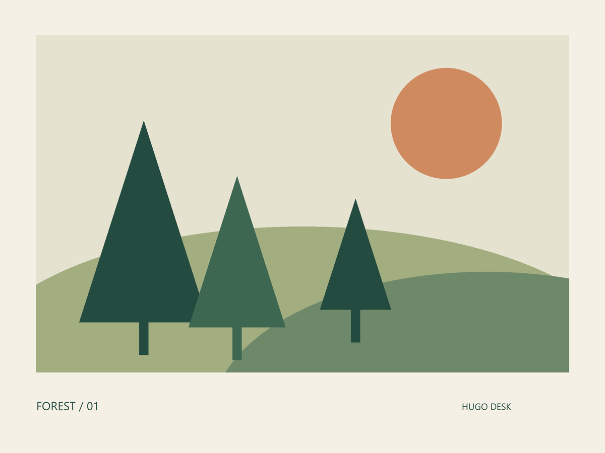
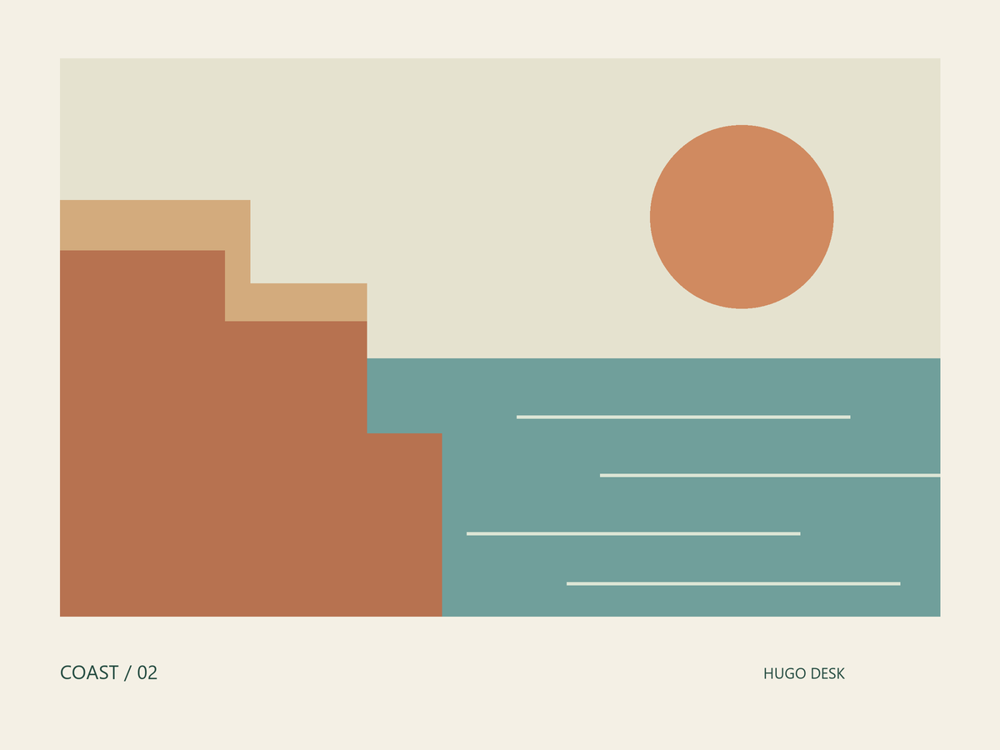
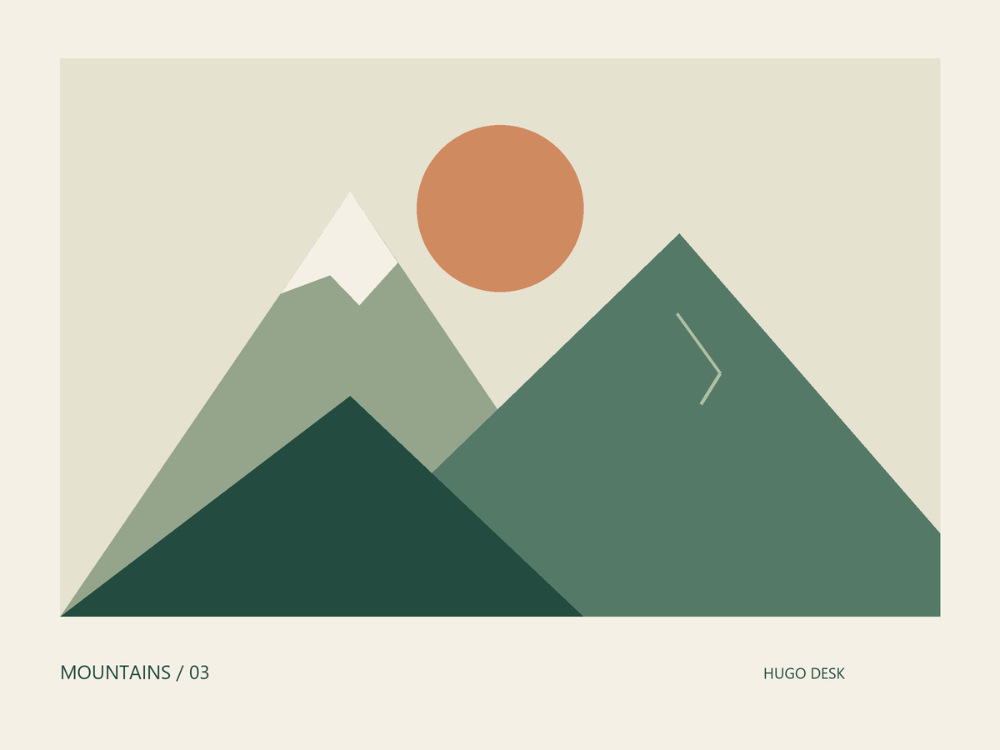

Keep article images beside `index.md`, including images in nested folders.
Expand **Assets** in Hugo Desk to browse this bundle, then click an image to
open it in the editor.

## More bundle images

These illustrations were created from scratch for Hugo Desk and are included
under the project's MIT license. See [credits](credits.txt).
